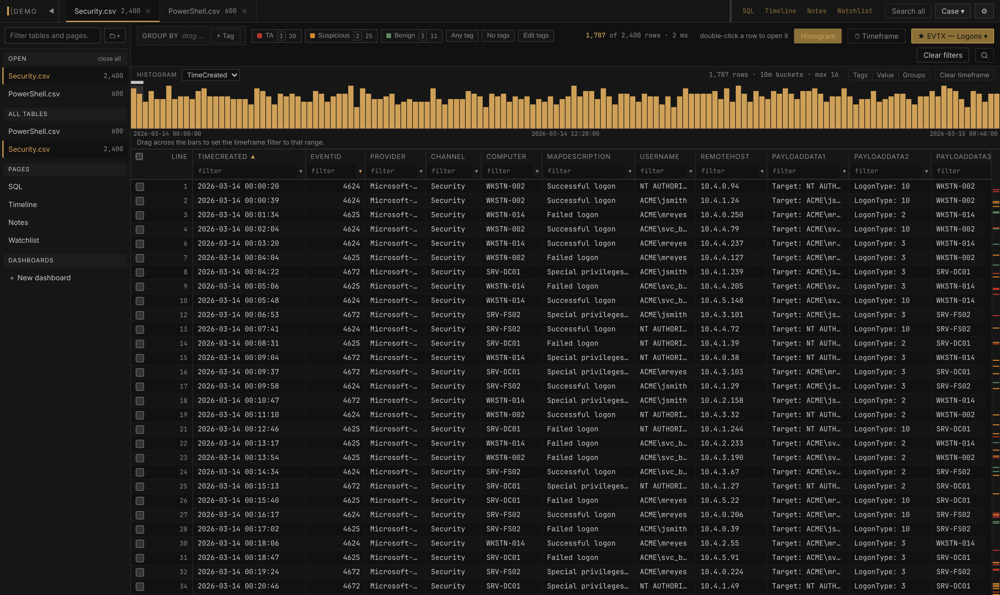
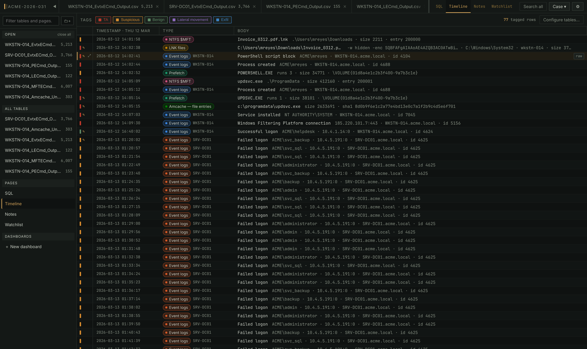
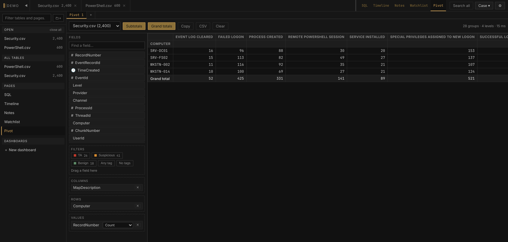

# Winnow

**A fast, local viewer for the enormous CSVs that DFIR triage produces** —
EvtxECmd, MFTECmd, Amcache, a whole KAPE output folder — with the
row-tagging workflow that turns a million log lines into a findings list.
Think Timeline Explorer, rebuilt for big files: a 1.2-million-row CSV
imports in about eight seconds, filtering it takes milliseconds, and
scrolling stays smooth however deep you are.



Everything runs on your machine — one Python server, no cloud, no build
step, works on an airgapped analysis box. A case is a single SQLite file
holding a copy of the rows you import and everything you do with them
(tags, notes, the watchlist, dashboards), so handing an
investigation to another analyst means handing over one file. **The
evidence files themselves are never modified.**

The [wiki](docs/wiki/Home.md) covers every feature in detail. This page is
the short version.

## Install

You need **Python 3.10 or newer**. Download **Source code (zip)** from the
[latest release](https://github.com/jacsonott/Winnow/releases/latest) and
unzip it where you want Winnow to live (or `git clone` this repository),
then from that folder:

```bash
pip install -r requirements.txt
python server.py
```

That's four packages — FastAPI, uvicorn, python-multipart and openpyxl.
Install from `requirements.txt` rather than by hand: openpyxl is imported
at startup for Excel support, and without it the server stops before it
binds. If pip refuses with "externally managed environment" (recent Linux
distributions, Homebrew's Python), use a virtual environment, and for an
airgapped box collect the wheels on a connected machine and carry them in;
[Installation](docs/wiki/Installation.md#installing-the-python-packages)
has the commands for both.

`python server.py` opens the home screen at <http://127.0.0.1:8777> in an
app window, falling back to an ordinary browser tab if no Chromium-family
browser is around. Create a case, then import from **Case ▾ → Import…** or
drag files onto the window. Closing the window is enough to stop Winnow:
the server exits on its own a couple of minutes later.

Would rather not touch a terminal? `launch/` has double-click launchers
for Linux, macOS and Windows ([launch/README.md](launch/README.md)), and on
Windows and Linux **Settings → File associations** puts Winnow in the OS's
*Open With* menu for the types it reads — per-user, no admin rights.

| flag | meaning |
| --- | --- |
| `--case FILE` | Open this case file (`.db-winnow`), creating it if missing |
| `--open A.csv B.csv` | Import delimited files into the case at startup |
| `--port`, `--host` | Defaults 8777 (the next free port when another Winnow has it) / 127.0.0.1 |
| `--force` | Open a case another Winnow still holds |
| `--no-browser` | Open no window; browse to the printed address yourself |
| `--no-idle-shutdown` | Keep running with no window connected, for scripts |

`python server.py --help` has the rest, and
[Installation](docs/wiki/Installation.md#command-line-options) explains
each, including serving to other machines with `--host` and
`--allow-host`. A case file is meant to be open in **one** Winnow at a
time, and shouldn't live on a network share — SQLite's locking doesn't
survive SMB/NFS. Two analysts on one investigation work in separate case
files and exchange session files.

**Updating in place** keeps your work: Settings → Updates, or
`python update.py` (`--from file.zip` is the airgapped route, `--dev`
tracks the develop branch, and `--rollback` undoes an update from the
command line). Nothing is ever fetched unless you ask.

## The loop

Filter down, tag what matters, read the findings back. That's the whole
model, and everything else is in service of it.


**Filter** by typing into the box under any column header — `svchost`
contains, `!svchost` doesn't, `=4624` exact, `^C:\Users` starts with,
`>1000` greater than, `/re/` regex, `a|b|c` any of, `""` empty, `*` not
empty. The `▾` opens that column's distinct values with counts,
Excel-style. A search box above the grid searches whole rows at once,
and the timeframe filter and histogram narrow by time. Twenty-seven
ready-made triage filters ship for EvtxECmd, RECmd and MFTECmd output, so
when an EvtxECmd export opens, Logons, RDP, Defender tampering, service
installs and scheduled tasks are one click away in **Filters ▾**.

**Tag** with `1`–`9`; `Shift` plus the digit tags the whole filtered view.
Counts live in the ribbon, a rail down the grid's edge shows where findings
cluster in the whole filtered view, and `Ctrl+Z` steps back through exactly
what each tag change touched. `?` opens Settings, which lists every key;
the navigation keys rebind there, and the tag digits are set per tag in the
tag editor.

**Read it back** on the case pages — Timeline, Search all, Watchlist,
Notes and dashboards.



- **Timeline** — every tagged row across every table, one chronological
  stream, with one-line summaries for the artefacts it recognises. Tag it
  and it's here; that's the model.
- **Search all** — sweep every table, open or closed, or just the ones you
  pick. Paste IOCs one per line for per-indicator, per-table hit counts.
- **Watchlist** — case-level indicators scanned across every table,
  including ones you import later, with optional auto-tagging and a count
  on the tab when new hits land.
- **Notes** — a Markdown scratchpad in the case file, with links to tables,
  SQL tabs and dashboards, and every row note listed under it.
- **Dashboards** — boards of widgets; click a number and the table opens
  filtered to those rows. A board plus your plugins saves as a **profile**
  for the next case of the same type. **KAPE triage** and
  **ESXi / UAC triage** ship ready to use.

## What else is in the box

- **Most things triage produces** — CSV and TSV with any delimiter, JSON
  and JSON Lines, SQLite databases (a browser `History`, say), Excel
  `.xlsx`/`.xlsm`, `.plaso` timelines, and any log file as raw text, one
  line per row. Archives (`.zip`, `.tar`, `.tgz` and friends, nested ones
  included) expand into a new folder, leaving the archive untouched, and
  folder import takes a whole KAPE output in one go.
- **Real datetime columns** — derive a sortable column from Unix epochs,
  FILETIME, WebKit, Mac absolute, .NET ticks, Excel serials, ISO 8601,
  RFC 2822, Apache and US-style dates, or year-less syslog. The original
  column is never touched.
- **Nested JSON and XML** — right-click a node in the detail pane to make
  it a column, or flatten a whole document at once. In event XML,
  `Data[@Name='LogonType']` picks a field by name, so the column means the
  same thing whatever the event ID.
- **More derived columns** — a regex capture, the first non-empty of
  several columns, the time between two columns, or a value looked up in
  another table, VLOOKUP-style.
- **Grouping** — drag a header into the Group by strip; nest levels, group
  by tag, tag a whole group without expanding it.
- **One view over several tables** — merge exports from a fleet and
  filter, sort, tag and export them as one. The tables don't need
  identical columns: a column only some have is empty for the rest, or
  keep just the shared ones.
- **Keep what matters** — save a filtered view, or just the rows you
  picked, as a new table of the case.
- **Sessions** — save named snapshots of your tags and notes inside the
  case, start a fresh pass without losing the first, compare two passes
  row by row, or hand a session file to another analyst who has the same
  evidence imported.
- **Export** — the current view or just its tagged rows as CSV, and every
  tagged row or every row of the whole case as XLSX, one worksheet per
  table. Cells that would run as spreadsheet formulas are neutralised in
  the export; the stored value is untouched.
- **A read-only SQL pane** for when a filter has done all it can. Each
  table is a `src_N` view carrying your derived columns, tags and notes,
  and results can be tagged, copied, exported to CSV or Excel, or saved as
  a new table:

  ```sql
  SELECT t.name, s.Process, count(*) n
  FROM row_tags rt
  JOIN tag_defs t ON t.id = rt.tag_id
  JOIN src_1 s ON s.rid = rt.rid
  WHERE rt.source_id = 1
  GROUP BY 1, 2 ORDER BY n DESC;
  ```

## Speed

1.2M rows × 10 columns (169 MB CSV), on an ordinary laptop:

| | |
| --- | --- |
| Import | 8.2 s (~147k rows/s) |
| Filter + sort 171k matching rows | 0.6 s |
| Fetch a page 150,000 rows deep | 1 ms |
| Full-text search across all columns | 8 ms |

The trigram index builds in the background after import, so the table is
browsable while it finishes; search falls back to substring scanning until
it lands. The index needs SQLite 3.45 or newer in your Python (`python -c
"import sqlite3; print(sqlite3.sqlite_version)"`); with an older one, every
search scans.

## Plugins



**Settings → Plugins → Manage plugins…** turns plugins on and off per
machine or per case, with no restart, and says what each one adds before
you switch it on (a plugin that is off is never imported, so its
description is read from its source, not by running it). Seven examples
ship switched off: **pivot** (Excel's PivotTable over any table),
**first_last** (collapse events into per-group session bookends),
**mft_usn** (raw NTFS `$MFT`/`$J` in pure Python, no EZTools),
**lateral_movement** (logons, RDP and share access followed host to
host in time order, by account, with credential switches and paths), **esxi_logs** (ESXi and UAC host logs into one schema),
**top_values** (a toolbar panel of a column's commonest values), and
**claude_assistant** (a Claude chat tab and a SQL Copilot that see the
case's *schema* — table and column names, row counts — never row data; it
needs network, `pip install anthropic` and an API key, which is why it is
opt-in).

A plugin is local Python running with Winnow's own privileges and nothing
is fetched from a network, so installing one is the consent step: only
install plugins you have read or trust. [Plugins](docs/wiki/Plugins.md)
covers each bundled one; writing your own is
[docs/writing-plugins.md](docs/writing-plugins.md) — a minimal ingest
format is about twenty lines.

## Documentation

The [wiki](docs/wiki/Home.md) is the manual. The manual for the latest
release is published as a website, with search, at
[winnow.jacson.tech](https://winnow.jacson.tech/), and
the project's [GitHub wiki](https://github.com/jacsonott/Winnow/wiki)
follows development:

- [Installation](docs/wiki/Installation.md) — requirements, launching,
  command-line options, updating and rollback
- [Cases and importing](docs/wiki/Cases-and-importing.md) — every
  supported format, folders and archives, import jobs
- [Filtering and searching](docs/wiki/Filtering-and-searching.md) and
  [Working with tables](docs/wiki/Working-with-tables.md)
- [Tagging and notes](docs/wiki/Tagging-and-notes.md) and
  [Timeline, Search all and the Watchlist](docs/wiki/Timeline-search-and-watchlist.md)
- [Derived columns](docs/wiki/Derived-columns.md),
  [Dashboards](docs/wiki/Dashboards.md) and the
  [SQL pane](docs/wiki/SQL-pane.md)
- [Sessions and export](docs/wiki/Sessions-and-export.md)
- [Plugins](docs/wiki/Plugins.md) and
  [Settings and shortcuts](docs/wiki/Settings-and-shortcuts.md)
- [Troubleshooting](docs/wiki/Troubleshooting.md)

## Contributing

Bug reports and pull requests are welcome. Open pull requests against the
`develop` branch; `main` holds releases only.
[Contributing](docs/wiki/Contributing.md) covers setting up, the test
suite and the few rules the code depends on, and
[docs/notes/](docs/notes/) holds the per-subsystem working notes.
`scripts/screenshots.py` regenerates the images above against the app as
it is today.

## License

[MIT](LICENSE).
