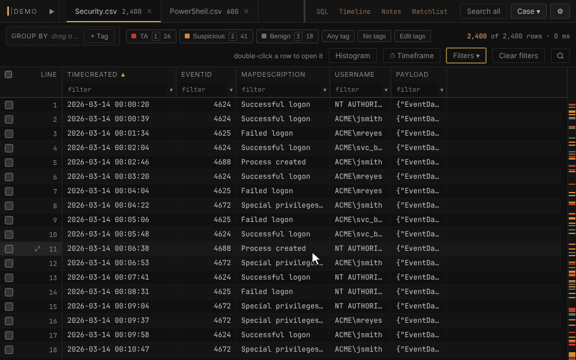

# Derived columns

A new column computed from one the table already has: a sortable time from
an epoch or a FILETIME, a field out of a JSON or XML document, a regex
capture, a URL or base64 decode, the first non-empty of several columns,
or a value looked up in another table. The original column is never
changed, and neither is the evidence file.

- Right-click a header and choose **Derive a column from this…**. The
  dialog previews what each sampled row becomes before anything is added.
- Right-click a field in the detail pane's JSON or XML and choose **Add as
  a column** to skip the dialog, or choose **Flatten JSON/XML into
  columns…** on a header to pick from every field the documents hold.
- Once built, it sorts, filters, groups and exports like any other column,
  and a derived datetime column works in the timeframe filter, the
  histogram and the Timeline.
- It is stored in the case file, values included, so it goes wherever the
  case goes.

**In the manual:** [Derived columns](../../wiki/Derived-columns.md)
