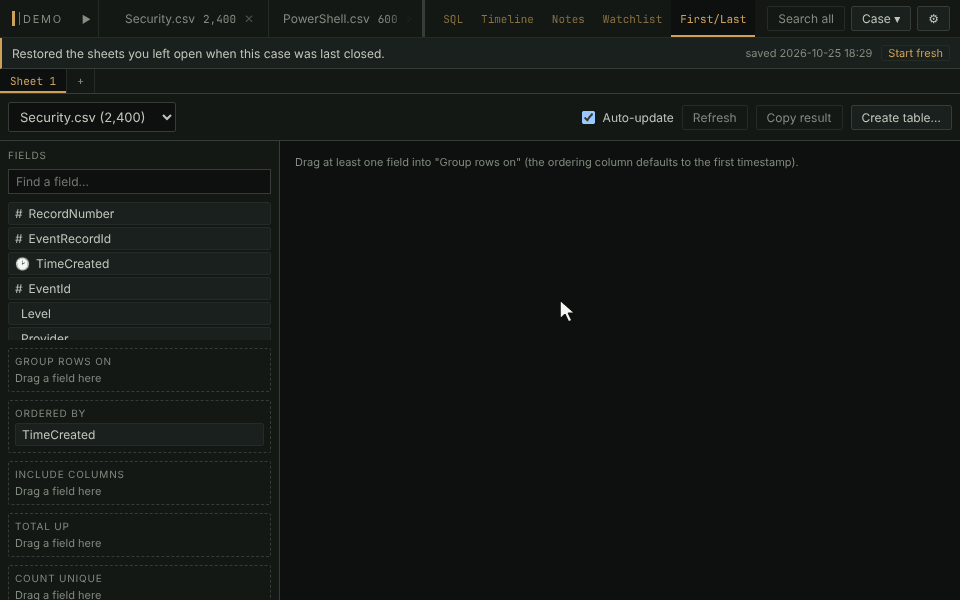

# First and last

Thousands of events down to the first and last of each group. Group a
table on the host, the user or both, and each group becomes two rows: the
event that opened it and the event that closed it. Forty thousand logons
become a few hundred session starts and ends that read as a story.

This is the bundled **first_last** plugin. It is off until you switch it on
in **Settings → Plugins → Manage plugins…**, which takes no restart.

- Click a field and pick a zone, or drag it there. **Group rows on** takes
  up to six columns, and **Ordered by** defaults to the table's first
  datetime column.
- **Include columns** carries columns onto each row. **Total up**,
  **Count unique** and **List values** sum up each whole group, not just
  its two ends.
- The tag chips at the top of **Filters** work as the Pivot's do: click
  one to group only its rows, right-click one to exclude it.
- A description template such as `{which} of {count}: {MapDescription}`
  says what each row is.
- **Create table…** writes the result into the case as a table you can
  tag, put on the Timeline and export. Merged tables work too.

**In the manual:** [Plugins › first_last](../../wiki/Plugins.md#first_last)
