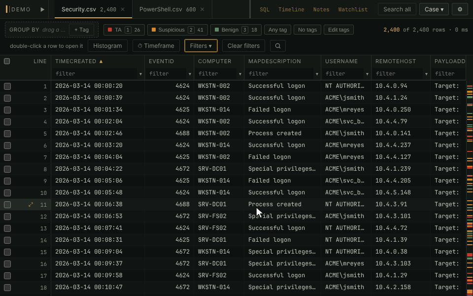

# Histogram

A bar chart above the grid of when the rows in view happened. It follows
every filter, so it shows where a search's hits cluster in time, and
dragging across it sets the timeframe.

- Click **Histogram** or press `h`. Winnow picks a bucket size, from a
  second up to a year, so a narrower range gets finer bars.
- **Tags** colors the bars by the tags their rows carry.
- **Value** charts one value against everything else: right-click a cell
  and choose **Show in histogram**.
- **Groups** colors the first few groups of a grouped grid, and puts a
  swatch of the same color on each group's heading.
- A mark along the top spans the rows on screen and moves as you scroll,
  and a line through the bars marks the selected row.
- Dashed lines mark each midnight, or the start of each week once the
  bars are a day or longer, with the date written under the chart.

**In the manual:** [Filtering and searching › The histogram](../../wiki/Filtering-and-searching.md#the-histogram)
