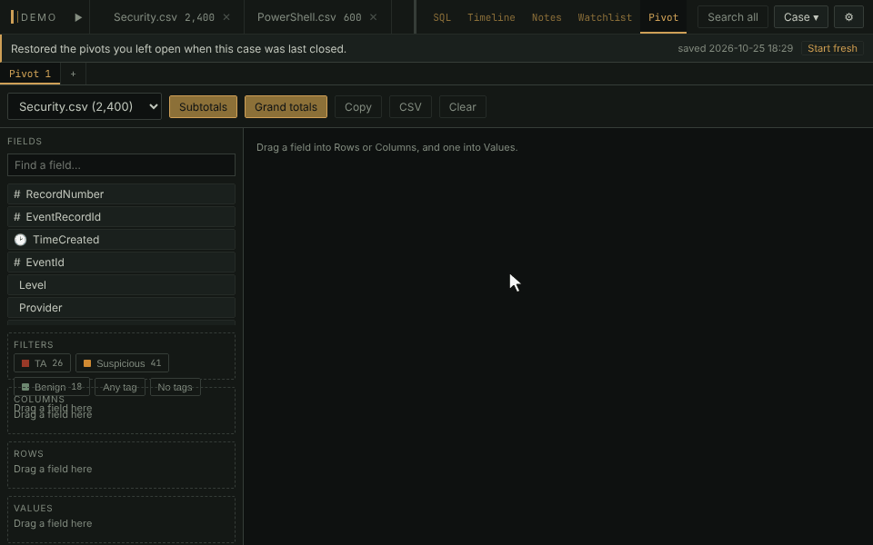

# Pivot tables

A spreadsheet-style cross-tab of any table, merged ones included. Put
fields in **Rows**, **Columns** and **Values**, and narrow the counts by
tag with the chips at the top of **Filters**.

This is the bundled **pivot** plugin. It is off until you switch it on
in **Settings → Plugins → Manage plugins…**, which takes no restart.

- Click a field and pick an area, or drag it there. Values can be Count,
  Distinct count, Sum, Average, Min or Max.
- The tag chips work like the tag ribbon above the grid: click one to
  count only its rows, a second to add its rows, right-click one to
  exclude it.
- Click any number to see the rows behind it.
- **Copy** and **CSV** take the result with you. Several pivots can be
  open as sub-tabs, and they are saved in the case.
- A pivot reads the whole table: the grid's filters, search and timeframe
  don't apply to it.

**In the manual:** [Plugins › pivot](../../wiki/Plugins.md#pivot)
