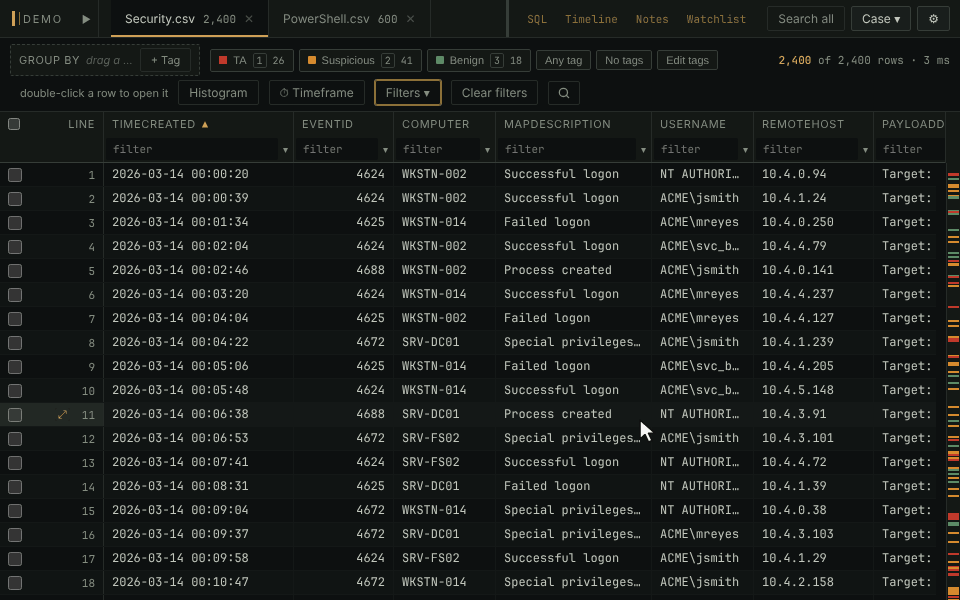

# Saved filters

A filter you build once is offered again on every table with the same
columns, in this case and the next. Winnow ships 28 of them for EvtxECmd,
RECmd and MFTECmd output, so a fresh export has a triage set before you
have saved anything.

- **Filters ▾** gets an accent ring when filters were saved for this
  table's exact columns, and lists them under **For this table**. Nothing
  is applied until you pick one.
- A saved filter keeps the builder's conditions, the sort, the search and
  any grouping. Applying one leaves the column boxes, the tag filter and
  the timeframe as they were, so a host typed into a column box narrows
  every filter you step through.
- `]` (or `w`) steps to the next filter for these columns and `[` (or `q`)
  to the previous. Past either end the table is unfiltered again rather
  than wrapping round.
- **Filters ▾ → Saved filters…** renames, reorders, edits and deletes
  them, and **Export filters…** takes them to another machine as JSON.

**In the manual:** [Filtering and searching › Saved filters](../../wiki/Filtering-and-searching.md#saved-filters)
