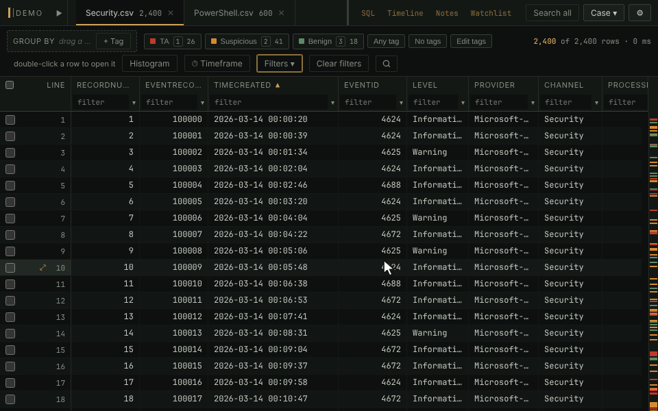

# SQL pane

Read-only SQL over the open case, for the questions a filter can't
answer: a count per user, a join between two tables, every tagged row with
its note. Tables appear as the grid shows them, with your derived columns,
tags and notes.

- Click **SQL** in the page tabs, write a query, and click **Run** or press
  `Ctrl+⏎`. From a table, `Q` opens its current filter as a `SELECT` to
  build on.
- Nothing you run can change the case: a write fails with *not
  authorized*.
- There is no row limit. A result is kept on disk and fetched as you
  scroll, so millions of rows scroll like a few, and a header click sorts
  all of them.
- Rows a result names can be tagged from the pane, and any result can be
  copied, exported to CSV or Excel, or saved as a table.

**In the manual:** [SQL pane](../../wiki/SQL-pane.md)
