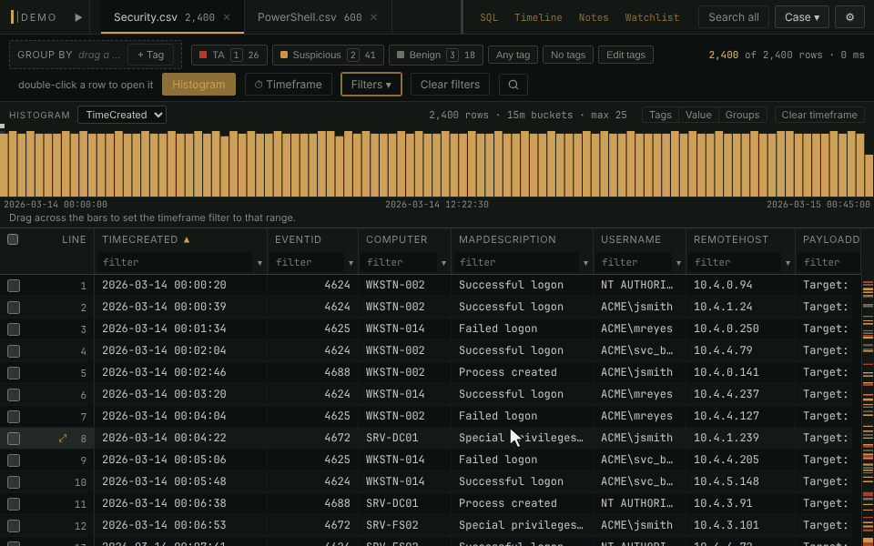

# Timeframe filter

Narrow the case to the hours that matter, and keep it narrowed. The
timeframe is kept apart from the other filters: clearing them, stepping
through saved filters or resetting the view leaves it on.

- Click **⏱ Timeframe** or press `R`, type a start and an end, and click
  **Apply**. Both ends are inclusive, either can be left open, and a date
  on its own means midnight.
- Compare one datetime column, or **All datetime columns**, which keeps a
  row when any of its timestamps is in range: a file whose creation time
  was changed but whose modified time wasn't is still caught.
- With **Keep applied when switching tables** on, the default, there is
  one timeframe for the whole case. Off, each table keeps its own.
- `r` turns it off without losing the range, and on again.
- **From tagged rows** fills in the range from the earliest and latest of
  your tagged rows.

**In the manual:** [Filtering and searching › The timeframe filter](../../wiki/Filtering-and-searching.md#the-timeframe-filter)
