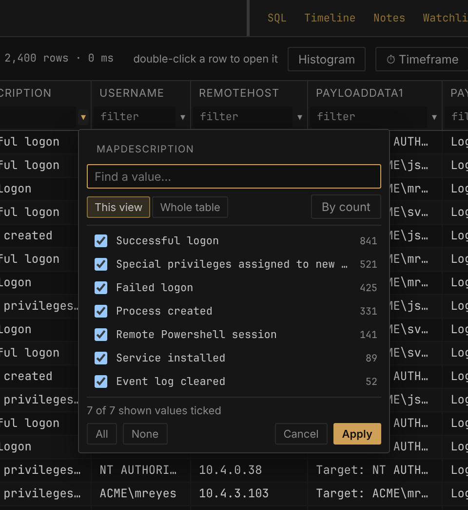

# Filtering and searching

Filtering is how a table of two million rows becomes the forty that matter. Winnow gives you several ways to narrow a table: a filter box under every column, a value picker, a filter builder for AND/OR logic, saved and shipped triage filters, a timeframe, a search box that reads every column, and the tag filter. They all stack, and none of them touches your data. Clearing them brings every row back. Each open table keeps its own filters and search when you switch to another tab and back; opening another case starts its tables with none.

## How filters combine

Every filter you set narrows the rows left by the others. Column filters, the filter builder, the search box, the tag filter, the timeframe and **Hide empty rows** are all applied together (AND). The line beside the toolbar shows how many rows are left, for example `58 of 400 rows`.

If nothing is left, the grid shows **No rows match** with a **Clear filters** button.

## The filter row

By default every column has a filter box under its header. Type into one and the grid updates as you type. `Enter` commits the filter and puts the focus back on the grid. `Escape` clears that box.

If you prefer a less crowded header, turn off **Settings → Grid & layout → Always-on filter row**. A filter bar then appears above the grid. It shows only the filters you have set, as chips you can click to edit or remove with ✕. To filter a new column, click the ⌕ on its header, or use **+ filter a column…**, which lists every visible column and lets you type to find one.

To filter from a cell, select it and press `f` to filter its column to that value. `F` does the same but drops every other filter first. Right-click a cell for the same choices, worded **Narrow to this value**, **Reset to this value** and **Exclude this value**, plus **Filter by values…**, which opens the value picker. **Reset to this value** keeps the timeframe. **Show in histogram**, in the same place, colors the value's rows in the histogram instead of filtering them; see [The histogram](#the-histogram).

### Filter syntax

| Type this | Matches | Notes |
| --- | --- | --- |
| `svchost` | cells containing the text | Ignores case for A–Z only |
| `!svchost` | cells not containing the text | Empty cells match too |
| `=4624` | cells exactly equal to the value | Case-sensitive |
| `!=4624` | cells not equal to the value | Case-sensitive; empty cells match too |
| `^C:\Users` | cells starting with the text | Ignores case for A–Z only |
| `>1000` `>=1000` `<1000` `<=1000` | greater than, at least, less than, at most | Numeric on number columns only (see below) |
| `/psexe(c\|svc)/` | a regular expression | Python syntax; ignores case in every script |
| `""` or `''` | empty cells | |
| `*` | cells with any value | |
| `a.exe\|b.exe\|c.exe` | cells exactly equal to any of the values | Case-sensitive, like `=` |
| `a.exe\|""` | cells equal to any of the values, or empty | `""` in a list is an empty cell |
| `=" padded "` `"a\|b"\|c.exe` | exact values that bare text can't hold | See [Quoted values](#quoted-values) |

Spaces at either end of what you type are ignored. An operator needs a value after it: a lone `=` or `!` is read as text to look for. There are no wildcards. A `%`, `_` or `*` inside a value is matched literally. An operator applies to everything after it, so `!a.exe|b.exe` means "does not contain the text `a.exe|b.exe`", not "neither of these"; use the filter builder for that.

**Settings → Filter & search syntax** has a short version of this table.

### Quoted values

Some exact values can't be typed bare: the box trims spaces at either end, a `|` would split a list, and a list that starts with `<`, `>`, `=`, `!`, `^` or `/` would read as an operator or a regular expression. Put those values in double quotes, in an `=` or `!=` filter or as items in a list:

| Type this | Matches |
| --- | --- |
| `=" padded "` | cells exactly equal to ` padded `, spaces included |
| `"cmd \| more"\|cmd.exe` | `cmd \| more` or `cmd.exe` |
| `"<unknown>"\|"/tmp/"` | `<unknown>` or `/tmp/` |

Inside quotes, `""` stands for one `"`. Quotes are only read this way when the value needs them. `="C:\Program Files\x.exe"` still matches the text with its quotes, as it always has, because a quoted path is a common value. The value picker and the `f` key write quotes for you when a value needs them, so you rarely type them yourself.

A value with a line break in it can't be put in the filter box at all.

### Case sensitivity

The contains, does-not-contain and starts-with filters ignore case for the letters A–Z only. `alpha` finds `ALPHA`, but `älpha` does not find `ÄLPHA`, and Cyrillic or accented text is matched exactly. To ignore case in any script, use a regular expression, such as `/älpha/`.

Equals (`=`), not-equals (`!=`) and lists (`a|b|c`) compare the exact text, case included: `=SVCHOST.EXE` and `=svchost.exe` give different results. The value picker writes exact values for you, so this rarely matters when you tick values there.

### Numbers, dates and text

When a table is imported, Winnow decides each column's type from its first 500 rows. A column is a number column if every non-empty value in that sample is a plain number such as `-12` or `3.5`. It is a datetime column if at least 80% of the sampled values look like dates. Every other column is text. A [derived column](Derived-columns.md) that extracts, decodes, combines or looks up values follows the same number rule, over all of its values rather than a sample, once it finishes building: a regex capture of byte counts is a number column. You can see each column's type in the table menu (`C`, or right-click a tab and choose **Columns…**).

The comparison filters (`>`, `>=`, `<`, `<=`) compare numbers only on number columns. On a text column they compare text, character by character, so `>1000` counts `30` and `N/A` as greater than `1000`. On a number column, a cell that isn't a number (such as `N/A` or a blank) never matches a comparison, and typing something that isn't a number after the operator shows a "Filter error" message.

When a filter can't run, such as a regular expression with a syntax error, Winnow shows a "Filter error" message that names the problem and keeps the rows you had.

## The value picker

The ▾ beside a column's filter box opens the value picker. It lists the column's distinct values with a count for each, most common first. Tick the values you want and click **Apply** (or press `Enter`). You can also open it with `v` for the column under the cell cursor.

| Control | What it does |
| --- | --- |
| **Find a value…** | Narrows the list as you type |
| **This view** / **Whole table** | Values among the rows the other filters leave, or every value in the column |
| **By count** / **A→Z** | Most common first, or alphabetical |
| **All** / **None** | Tick or untick every value shown |
| **Apply** / **Cancel** | Apply the selection, or close without changing anything |

The picker starts on **This view**, so the list reflects your other filters. If the column already has a value selection, it starts on **Whole table** so that you can widen the selection again. Empty cells are listed as `(empty)`.

The picker writes an ordinary filter into the column's filter box: one value becomes `=value`, several become `a|b|c`, and `(empty)` ticked alongside other values becomes `""` in the list. A value that needs [quotes](#quoted-values) gets them, such as `"a|b"|c` or `=" padded "`. **Apply** with nothing changed leaves the column's filter as it is. Ticking every value in a complete list removes the filter, unless the list is **This view** and the column's own filter decided what it lists: after a filter such as `svchost`, `>30` or `!p1` on the column, the picker lists only the values that filter leaves, and ticking them all filters to exactly those values. The one selection the box can't hold is a value with a line break in it; Winnow applies that through the filter builder instead and tells you so ("applied under Filters ▾").

The list holds the 1,000 most common values at most. When a column has more, the picker says so. The **Find a value…** box only searches the values already listed, so to reach a rarer value, narrow the column first (for example with a contains filter) and reopen the picker.

The ▾ buttons appear automatically on tables under 250,000 rows, because reading a column's values means scanning it. To change that, open the table menu's **Value dropdowns** section and choose **Auto · under 250,000 rows**, **On** or **Off** for the table. The same section lists every column with its own **Auto**, **On** and **Off**, to force the dropdown on or off for that column; **Set back to Auto** at the bottom undoes those. Each column in the **Show, hide & order** list also has a ▾ button that does the same for its column.

### Stacking a column

Right-click a column header and choose **Stack values (rarest first)…** to see the column's values for the current view as a bar chart: one bar per value, every bar to one scale, with round numbers along the top and the **Share** of the rows counted at the end of each bar. Over the chart are how many **distinct values** the column has, the **rows counted** and how many values are **seen once**.

- **Rarest first** is where one-off command lines and odd hosts show up; **Most common** turns it round.
- Click a bar to filter the grid to that value. Right-click a bar, or click its **⋯**, for **Filter to this value**, **Exclude this value** and **Copy value**.
- Point at a bar, or move to it with the arrow keys, and the line under the chart gives its value, its rows and its share. `Enter` filters to it.
- **Filter values…** narrows the chart to the values that contain what you type. Each bar keeps its length.
- The table's other columns are down the left, with their type or the filter on them: click one to stack it instead. **Find a column…** searches them, and ☆ pins a column you stack often.

A few values get broad bars; a long tail gets thinner ones and scrolls. Stack counts up to 1,000 values and draws 500 at a time. When there are more, the line under the chart says so: filter the grid, or the values, to reach the rest.

To take every value away as a list instead, **Copy unique values** in the same menu puts the column's distinct values for the current view on the clipboard, one per line (see [Copying](Working-with-tables.md#copying)).

## The filter builder

The filter builder is for logic the filter row can't express, such as "EventId is 4624 or 4625, and LogonType is not 3". Open it from **Filters ▾ → Filter builder…** or press `e`.

A filter is a group of conditions. In the **Match … of:** line at the top of each group, choose AND (every condition must hold) or OR (any one is enough). Use **+ condition** to add a condition and **+ group** to nest another group. Each condition takes a column, an operator and a value:

| Operator | Notes |
| --- | --- |
| contains, does not contain, starts with | Ignore case for A–Z only |
| equals, does not equal | Case-sensitive |
| matches regex | Python syntax; ignores case |
| > (numeric), >= (numeric), < (numeric), <= (numeric) | |
| is empty, is not empty | No value needed |
| is any of (one per line) | Exact values, one per line |

A datetime column gets a 📅 date picker next to the value. When you open the builder, any filters in the column boxes move into it as conditions, so the builder always shows the whole filter.

The conditions are on the left, under **Conditions**. The right side says what they come to: how many **rows match** in the whole table, counted again as you change anything, beside the **rows in the table** and the number of **conditions**. The search box, the tag filter and the timeframe narrow the grid further, so the grid can show fewer (a merge isn't counted here: apply the filter and read the grid's count). Under the counts, **SQL** shows the same filter as a SQL expression. You can edit either side and they stay in step. If you type SQL that the guided editor can't show, the builder switches to raw SQL mode and says so. A `LIKE` becomes a guided condition only when it means exactly the same thing: `'%text%'` is contains and `'text%'` is starts with, as long as the text has no other `%` or `_` in it. Any other `LIKE`, such as `'%.exe'`, `'p_.exe'` or `'P1.EXE'` (which ignores case, unlike equals), stays as raw SQL and filters exactly as typed. A contains or starts with whose value holds a `%` or `_` is shown with an `ESCAPE '\'` clause, so the SQL matches those characters literally, as the condition does. **Start over with the guided editor** leaves raw mode. Raw SQL is checked when you click **Apply**, and an error is shown under the box. Only plain conditions are accepted: no `SELECT`, no `;` and no comments.

The **Group by** section under the SQL lets a filter carry a grouping too (see [Grouping rows](Working-with-tables.md#grouping-rows)). Along the bottom, **Apply** runs the filter, **Clear** empties the conditions, **Save filter…** keeps it (see [Saved filters](#saved-filters)) and **Saved filters…** opens the list.

To see the current filter as a full query, press `Q`. It opens in a new tab of the [SQL pane](SQL-pane.md).

## Saved filters

Click **Save filter…** in the filter builder to keep a filter. A saved filter stores the builder's conditions, the sort, the search box and any grouping. It is saved for the table's set of column names and lives outside the case, so it is available in every case you open.

When you open a table whose columns exactly match a saved filter, **Filters ▾** gets an accent ring (until you apply something) and lists the filter under **For this table**. Filters saved for a similar but not identical set of columns are listed with "(similar)" after the name. Nothing is applied until you pick one. While one is applied, the button reads **★** followed by the filter's name.

To step through the saved filters made for exactly this table's columns, press `]` or `w` for the next and `[` or `q` for the previous. Past either end the filters are cleared rather than wrapping round, so pressing `q` repeatedly always ends on the unfiltered table.

Applying a saved filter replaces the builder's conditions, the search and the grouping. It leaves the column boxes, the tag filter and the timeframe as they were, so a host filter in a column box keeps narrowing each saved filter you step through.

**Filters ▾ → Saved filters…** opens the full list. Down its left are **Every saved filter** and, under **Header sets**, each set of columns that has filters saved for it, with the open table's set first and marked *open table*. It opens on the open table's set. A set's own list says which columns it is, and **Nickname…** (**Rename nickname…** once it has one) gives it a shorter name, used here, in **Filters ▾** and in the Tables manager. **Every saved filter** lists every filter, under a heading for its set. **Filter by name, nickname or column…** narrows the list. Click a filter's name to apply it. Drag a filter up or down within its column set to change the order `[` and `]` step through. Each filter's **⋯** menu has:

- **Edit…**: applies the filter to the open table and opens it in the builder, where `Update "name"` saves over it and **Save as new…** keeps both. It needs a table open.
- **Rename…**
- **Move up** and **Move down**: the same reordering as dragging, from the keyboard.
- **Delete…**, which asks first.

**Export filters…** and **Import filters…**, along the bottom, move them between machines as a JSON file. The same buttons are in **Settings → Saved filters**. **Filter builder…** beside them opens the builder on the open table.

### Shipped triage filters

Winnow ships 27 ready-made triage filters for EvtxECmd, RECmd and MFTECmd output. They are added to your saved filters the first time Winnow runs, and they are offered like any other saved filter: nothing is applied until you pick one. If you delete or rename one, it stays that way. When an update stops shipping one, it leaves your list too, unless you edited or renamed it.

| Column set | Filters |
| --- | --- |
| Event logs (EvtxECmd) | 19 filters named `EVTX — …`: log clearing and Defender off; Defender detections and tamper; logons; incoming and outgoing RDP; Sysmon present; network share access (5140/5145); service installs; WMI; process create/exit (4688/4689); crashed applications; user and group changes; PowerShell; firewall rule changes; scheduled tasks; BITS transfers; Group Policy (client and DC); system shutdowns |
| Registry (RECmd batch) | 5 filters named `Registry — …`: basic system info; audit and PowerShell policy; TypedPaths / RecentDocs; UserAssist / BAM; Run keys (autoruns) |
| NTFS $MFT (MFTECmd) | 3 filters named `MFT — …`: executables in odd places; Startup folder and run-key paths; a suspicious tool sweep that uses Advanced search |

A few of them also group the result: `EVTX — PowerShell` and `EVTX — BITS transfers` group by `PayloadData1`, and `Registry — UserAssist / BAM` groups by `HivePath`.

## The timeframe filter

The timeframe filter keeps rows whose timestamp falls inside a range. Click **⏱ Timeframe** or press `R` to set it, then click **Apply**, which always turns it on:

- **Keep applied when switching tables** decides whether the timeframe follows you to the next table (see below). It is on by default and is saved as soon as you click it.
- **Column** is one datetime column, or **All datetime columns (catches a match on any of them)**. With all columns, a row is kept if any of its timestamps is in range, which catches a file whose creation time was changed but whose modified time wasn't.
- **Start** and **End** take `YYYY-MM-DD HH:MM:SS` in 24-hour time. A date alone, or a date with `HH:MM`, also works, and you can set only one end. The 📅 button opens a date picker.
- **From tagged rows** with **Fill range** sets the range to the earliest and latest timestamps among your tagged rows (all tags, or only the tags you toggle). It only fills the boxes; **Apply** still turns the filter on.

Both ends are inclusive. A date without a time means midnight at the start of that day, so an end of `2024-01-05` stops at `2024-01-05 00:00:00`. To include the whole day, end at `2024-01-05 23:59:59`.

The timeframe understands timestamps written as `2024-01-05 13:22:01` (or with a `T`), US-style `1/5/2024 1:22:01 PM`, and month names such as `Jan 5 2024` or `Jan 5th, 2024 1:22 PM`. Fractions of a second and time-zone offsets in the data are ignored: the comparison uses the date and time as written. Rows whose timestamp can't be read are left out while the timeframe is on.

The timeframe stays on when you clear filters, apply a saved filter or reset the view, and the button shows ⏱ followed by the column name while it is active. Press `r` to turn it off without losing the range, and `r` again to turn it back on; opened while it is off, the dialog says *Off right now — Apply turns it back on.* **Clear** in the dialog removes it. A table with no datetime column is not narrowed by it at all.

What happens when you switch tables depends on **Keep applied when switching tables**:

- **On** (the default): there is one timeframe for the whole case, and every table you open is narrowed by it.
- **Off**: each table keeps its own timeframe, the way it keeps its own filters. A table you have not set one on opens without one, and going back to a table puts back the timeframe it had.

The same switch is in Settings, under **Filter & search syntax**.

**Jump to timestamp…** in the same dialog (or `J`) scrolls to the row closest to a moment instead of filtering. Press `.` in any table to jump to the same moment again.

## The histogram

Click **Histogram** or press `h` to show a bar chart above the grid of when the rows in the current view happened. Choose which datetime column to chart from its list. Only the columns shown in the grid are in that list: a column you have hidden is left out, and if you hide the column being charted, the histogram switches to another one straight away. Show your chosen column again and the histogram goes back to it. The line beside it gives the row count, the bucket size and the tallest bar. Winnow picks a bucket size, from one second up to a year, that gives bars a few pixels wide across the strip, so narrowing the timeframe gives finer buckets. Hover a bar to see its time range and row count.

Dashed lines behind the bars mark the days or the weeks, as on the [Timeline's overview](Timeline-search-and-watchlist.md#the-overview). While the bars are shorter than a day, a line marks each midnight. Once they are a day or longer, or the days are too close together to tell apart, a line marks the start of each week (Monday) instead, and when even the weeks are too close, there are none. Under the chart, each line is labeled with its date in ISO form, such as **2026-03-11**, where there is room between the start and end times. Like every time on the chart, they are in UTC. Hover a line to see the day it marks.

Three buttons color the bars, one at a time; click the pressed one again to go back to plain bars. In each, a row counts once, so the bars stay as tall as the plain ones.

- **Tags** colors the bars by tag: each row counts under the first tag it carries, with untagged rows underneath.
- **Value** colors the rows holding one value, as if they were tagged, and grays out everything else. To choose the value, right-click a cell and choose **Show in histogram**; that also opens the histogram if it is closed. The value stays charted while you click around the grid. To have the chart follow the selected cell instead, right-click **Value** and choose **Follow the selected cell**; then clicking another cell, or moving to one with the arrow keys, charts its value. Right-click **Value** again to turn that off. The line beside the chart names the value and how many rows hold it. A very long value, such as a whole JSON document, is too long to chart, and the strip says so.
- **Groups** works while the grid is grouped: the first 3, 5 or 8 groups (pick with **First 3**, **First 5** or **First 8**) each get a color, and everything else counts as "Other". Each of those groups' headings in the grid gets a swatch in the same color. A group keeps its color when a filter moves it up or down the list. With nested grouping, the colors go to the first level's groups.

While the view is changing (a filter, a search, a sort, the timeframe) and until its new chart has loaded, the old chart is faded and gray and the line beside it says "Updating…", so a chart at full strength is always the one for the rows in the grid.

Drag across the bars to set the timeframe filter to that range on the charted column. **Clear timeframe** removes it again. The histogram follows every filter, so it is a quick way to see where a search's hits cluster in time. It stays open when you open another case and charts that case's table once it has loaded; a case with no table open shows "Open a table to chart when its rows happened."

The histogram also shows where you are in the table. A mark along the top of the chart covers the time span of the rows on screen and moves as you scroll, and a line through the bars marks the selected row. When the rows on screen are not in time order, as when the table is sorted by a process ID, they are spread across the chart, so each one gets a short tick of its own instead. Hover a mark to see the times it stands for.

If the table has no datetime column, the histogram says so. You can make one from a text timestamp; see [Derived columns](Derived-columns.md). If it has datetime columns but every one is hidden, the histogram says "Every datetime column in this table is hidden — show one from the table menu's Columns list to chart it." See [Showing and hiding columns](Working-with-tables.md#showing-and-hiding-columns).

## The search box

The search box looks for text anywhere in a row. Click the magnifier, or press `/` or `Ctrl+F`, to open it. It has three modes:

| Mode | How it matches |
| --- | --- |
| **Contains** | The text appears anywhere in the row. Ignores case for A–Z only. |
| **Regex** | A Python regular expression. Ignores case in every script. |
| **Advanced** | Several terms joined with AND or OR, each of which can be negated |

Search reads the row as its imported columns joined by single spaces. That means a search can match across a column boundary (`exe 1500` finds a row whose Process ends in `exe` and whose next column is `1500`), and a regex `^` anchors to the start of the first column, not of each cell. Derived columns are not searched; filter them with their column box instead.

`Ctrl+F` is taken over on purpose. The browser's own find only sees the rows currently drawn on screen, so it would report "not found" for rows that are there.

`Enter` runs the search and returns to the grid. `Escape` clears it.

### Advanced mode

In Advanced mode, each term is a separate box. Use **+ term** to add one, the AND/OR list to join it to the previous term, **NOT** to exclude rows containing it, and ✕ to remove it. NOT works on any term, including the first. AND binds tighter than OR, as in SQL, so `a AND b OR c` means "(a and b) or c". With more than six terms the bar collapses to a one-line summary; click it to expand, and **▴ minimize** to collapse it again.

### The search index and slow searches

Winnow builds a search index for each table in the background, and the **Indexes** section of the Tables manager (`t`) shows whether it is ready. **Build** there starts one now rather than on the first search that needs it. Contains and Advanced searches use it once it is ready, for terms of three characters or more. Shorter terms, and every search before the index exists, scan the whole table instead. The results are the same either way; only the speed differs. The hint at the right of the search box says which is happening: `substring`, `substring · index building`, `advanced · full-text`, or `regex · full scan`. Regex never uses the index.

If a search takes longer than five seconds, it carries on in the background and the rows you had stay on screen. When it finishes, a "Search finished" message offers **Apply**. Typing a new search, or `Escape` in the box, cancels it.

### Regular expressions that are refused

Winnow checks every regular expression before running it, in filters and in search. It refuses patterns whose repeated group can match the same text in more than one way, such as `(a+)+$` or `(a|aa)+`. On a hostile cell those can take practically forever, and nothing can stop them once started. The error message explains the problem. To fix such a pattern, make each repetition end at something it can't itself match, use a character class instead of alternatives, or use Contains.

## Filtering by tag

The tag chips above the grid also filter. Click a tag to show only rows carrying it. Clicking a second tag shows rows carrying either. **Any tag** shows every tagged row and **No tags** shows the rows nobody has tagged yet, which is what is left to go through. Right-click a tag and choose **Exclude *tag*** to hide the rows carrying it; the chip is struck through until you click it again. See [Tagging and notes](Tagging-and-notes.md) for tagging itself.

## Clearing filters

**Clear filters** in the toolbar, or `c`, removes the column filters, the filter builder's conditions, the search, the tag filter and any grouping. It keeps the timeframe, the sort and **Hide empty rows**. If the row under the cursor is still there afterwards, it stays selected, so you see it in context. Grouping cleared this way can be brought back with `X`.

**Reset view** in the table menu does the same and also restores the table's default sort.

To remove only the timeframe, use **Clear** in the timeframe dialog or **Clear timeframe** on the histogram.

## Undoing a filter change

Press `z` to undo the last filter change on the table you are looking at. Press it again to keep stepping back through earlier ones. It covers the column filters, the value picker, the filter builder, the search box, the tag filter and the timeframe, so one press also brings back the filters and search that **Clear filters** removed. Grouping comes back with `X`, as before. A word typed into a filter box or the search box comes back as one step, not a letter at a time. The sort, grouping and **Hide empty rows** are left as they are.

Each table keeps its own list, so `z` never changes another table's filters. The list is gone once the tab is closed or another case is opened. Undoing a tag is a different key, `Ctrl+Z`; see [Tagging and notes](Tagging-and-notes.md#undo).

## Keys

| Key | Action |
| --- | --- |
| `f` / `F` | Filter by the selected cell's value / the same, dropping other filters |
| `v` | Value picker for the cell's column |
| `e` | Filter builder |
| `]` or `w` / `[` or `q` | Next / previous saved filter |
| `c` | Clear filters, search and tag filter |
| `z` | Undo the last filter change |
| `/` or `Ctrl+F` | Search box |
| `r` / `R` | Toggle the timeframe / open the timeframe dialog |
| `h` | Histogram |
| `J` or `a` / `.` | Jump to timestamp / jump again |
| `Q` | Open the current filter in the SQL pane |

Every key can be changed; see [Settings and shortcuts](Settings-and-shortcuts.md).
