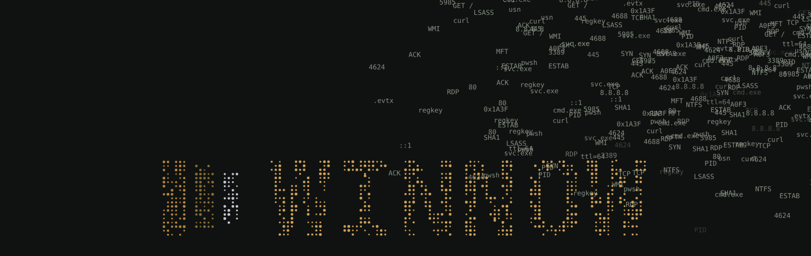

# What is winnowing?

Winnowing is how farmers separate grain from chaff, and Winnow is named
for it.

## On the farm

After a harvest, the grain is mixed in with **chaff**: light, papery husks
and bits of straw. To separate them, farmers toss the mix into the wind.
The heavy grain falls straight back down, and the wind blows the chaff
away. That's where the phrase "separate the wheat from the chaff" comes
from.

## In Winnow

A triage export is the same kind of heap: millions of rows of routine
activity, with the few that matter mixed in. Winnow is the wind.

| On the farm | In Winnow |
| --- | --- |
| The heap | The tables you import |
| The wind | Filters and searches |
| The chaff | The rows a filter hides |
| The grain | The rows you tag |

Unlike on the farm, nothing is thrown away. A filter only hides rows, so
you can clear it and toss the heap again.

## Where you'll see it

- **The launch animation:** event IDs and process names blow off the
  screen while the grain lands as the wordmark.
  [Settings](Settings-and-shortcuts.md#launch-animation) can turn it off.
- **The tagline:** "separate the signal from the noise".
- **The Harvest skin and the logo:** gold for the grain, gray for the
  chaff.
